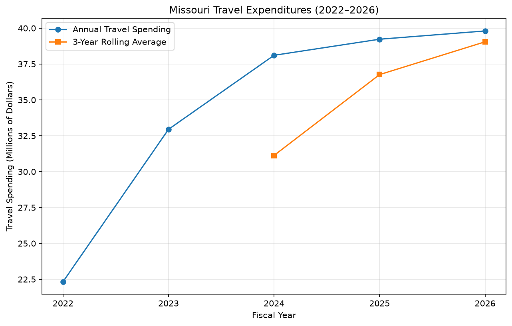

# cintel-04-rolling-monitoring


[](pyproject.toml)
[](https://github.com/Angie-Crews/cintel-04-rolling-monitoring/actions/workflows/ci-python-zensical.yml)
[](https://angie-crews.github.io/cintel-04-rolling-monitoring/)

[](https://docs.astral.sh/uv/)
[](https://docs.astral.sh/ty/)
[](https://zensical.org/)
[](LICENSE)

> Monitor time-series measurements using rolling statistics.

## Project Overview

Author: Angie Crews

Date: 2026 November

This project introduces rolling monitoring using
Missouri State Expenditures travel data.

The goal is to use rolling averages to monitor
travel spending over time, identify trends,
and detect unusual changes in expenditures.

The project is configured in
[pyproject.toml](pyproject.toml).

## Data

This project uses Missouri State Expenditures data
for fiscal years 2022 through 2026.

The datasets were downloaded from the
[Missouri Open Data Portal](https://data.mo.gov/).

The analysis includes:

- 526,244 total expenditure records.
- 178,028 records classified as TRAVEL.
- Five fiscal years of annual spending data.

Each record includes fiscal year, agency name,
category, detail description, vendor name,
and payment amount.

The five original CSV datasets are stored locally
in `data/` and are excluded from GitHub because
of the project's file-size restrictions.

The source datasets can be downloaded from the
Missouri Open Data Portal.

### Source Dataset Files

The following five CSV files are required
to run the Missouri travel analysis:

| Fiscal Year | CSV Filename |
|---|---|
| 2022 | `2022_State_Expenditures_20261109.csv` |
| 2023 | `2023_State_Expenditures_20261109.csv` |
| 2024 | `2024_State_Expenditures_20261109.csv` |
| 2025 | `2025_State_Expenditures_20261109.csv` |
| 2026 | `2026_State_Expenditures_20261029.csv` |

Download the datasets from the
[Missouri Open Data Portal](https://data.mo.gov/)
and save them in the `data/` folder.

The filenames must match those referenced in
`src/cintel/missouri_travel_monitor.py`.

## Approach

This project uses Python and Polars to monitor
Missouri travel spending across five fiscal years.

The analysis follows these steps:

1. Load and combine expenditure datasets for 2022–2026.
2. Filter records classified as `TRAVEL`.
3. Convert payment amounts into numeric values.
4. Calculate total travel spending for each fiscal year.
5. Calculate a three-year rolling average.
6. Save the results to `artifacts/missouri_travel_rolling.csv`.
7. Generate a chart comparing annual spending with
   the three-year rolling average.

The rolling average uses the current fiscal year
and the two preceding years.

This helps smooth annual fluctuations and
identify longer-term spending trends.

## Run the Project

### Set Up the Environment

Clone the repository and open the project folder
in VS Code.

Install the project dependencies:

```powershell
uv sync
```

### Run the Missouri Travel Analysis

Download the five annual expenditure datasets
(2022–2026) from the
[Missouri Open Data Portal](https://data.mo.gov/).

Place the CSV files in the `data/` folder using
the filenames expected by
`src/cintel/missouri_travel_monitor.py`.

Run the analysis:

```powershell
uv run python -m cintel.missouri_travel_monitor
```

The script generates two output files:

- `artifacts/missouri_travel_rolling.csv`
- `docs/images/missouri_travel_rolling.png`

### Run the Tests

```powershell
uv run pytest
```

### Build the Documentation

```powershell
uv run zensical build
```

## Results

The analysis identified 178,028 Missouri travel
expenditure records from fiscal years 2022–2026.

### Annual Travel Spending

| Fiscal Year | Total Travel Spending | 3-Year Rolling Average |
|---|---:|---:|
| 2022 | $22.33M | N/A |
| 2023 | $32.95M | N/A |
| 2024 | $38.11M | $31.13M |
| 2025 | $39.23M | $36.76M |
| 2026 | $39.81M | $39.05M |

Annual travel spending increased across all five
fiscal years.

The three-year rolling average increased from
$31.13 million in 2024 to $39.05 million in 2026,
indicating an upward spending trend.

### Travel Spending Chart



### Output Files

- [Missouri Travel Rolling Results](artifacts/missouri_travel_rolling.csv)
- [Project Documentation](docs/index.md)

## Project Documentation

The complete Missouri Travel Rolling Monitoring
report is available on GitHub Pages.

**[View Published Project Documentation](https://angie-crews.github.io/cintel-04-rolling-monitoring/)**

The documentation includes:

- Project overview and data sources.
- Methods used to calculate rolling averages.
- Annual travel spending results and chart.
- Interpretation of spending trends.
- Limitations and conclusions.

### Project Links

- [GitHub Repository](https://github.com/Angie-Crews/cintel-04-rolling-monitoring)
- [Python Analysis Script](src/cintel/missouri_travel_monitor.py)
- [Results CSV](artifacts/missouri_travel_rolling.csv)

## Developer Reference

Follow the
[Professional Python Workflow Guide](https://denisecase.github.io/pro-analytics-02/)
for **detailed instructions and troubleshooting**.

### Initialize and Update the Python Environment

With the project open in VS Code, open a VS Code terminal.
Paste each command and hit Enter or Return after to run it.

```shell
uvx pup-clean --delete
uv self update
uv python pin 3.14
uv python install
uv lock --upgrade
uv sync
uv audit
```

### Set Up and Run Git Hooks

Set up and run the git hooks to perform
basic checks automatically before
any changes get pushed to GitHub.

In the VS Code terminal,
paste each command and hit Enter or Return after to run it.

```shell
uvx prek install --force
uvx prek update --freeze --cooldown-days 7

git add -A
uvx prek run --all-files
# repeat if changes were made
uvx prek run --all-files
```

### Run Common Chores

Run linters, formatters, type checks, tests, and
build the documentation.

```shell
uv run ruff check . --fix
uv run ruff format .

uv run ty check
uv run python -m pytest
uv run python -m zensical build
```

### Git add-commit-push to GitHub

After making useful changes, save your work to GitHub.

```shell
git add -A
git commit -m "describe your changes in quotes"
git push -u origin main
```

## Developer Notes

- Use the **UP ARROW** and **DOWN ARROW** in the terminal to scroll through past commands.
- Use `CTRL+f` to find (and replace) text within a file.

## Developer Tools

This project uses professional Python tools to support development,
testing, documentation, and code quality.

- [uv](https://docs.astral.sh/uv/) - Python environments and dependencies.
- [Ruff](https://docs.astral.sh/ruff/) - Python linting and formatting, configured in [.ruff.toml](.ruff.toml).
- [ty](https://docs.astral.sh/ty/) - Python type checking.
- [pytest](https://docs.pytest.org/) - automated Python testing, configured in [.pytest.toml](.pytest.toml).
- [prek](https://prek.j178.dev/) - Git hooks and automated checks, configured in [prek.toml](prek.toml).
- [Zensical](https://zensical.org/) - project documentation, configured in [zensical.toml](zensical.toml).

## Links

- [Hosted Documentation](https://angie-crews.github.io/cintel-04-rolling-monitoring/)
- [Professional Python Workflow Guide](https://denisecase.github.io/pro-analytics-02/)
- [Citation](CITATION.cff)
- [License](LICENSE)
