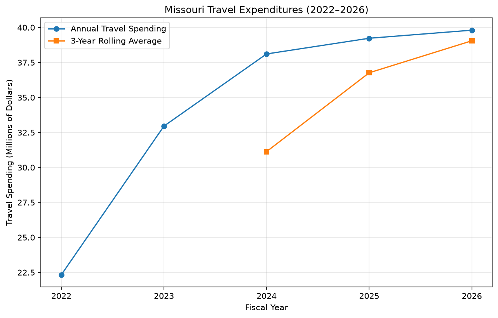

# Missouri Travel Expenditures: Rolling Monitoring

Continuous Intelligence | Project 04 | Custom Report

## Overview

This project analyzes Missouri State Expenditures
travel spending from fiscal years 2022 through 2026.

Using a three-year rolling average, the analysis
examines annual travel spending patterns and
identifies changes in expenditures over time.

The goal is to demonstrate how rolling monitoring
can help identify spending trends and support
financial analysis and decision-making.

## Data

The project uses Missouri State Expenditures data
for fiscal years 2022 through 2026.

The datasets were downloaded from the Missouri
Open Data Portal (data.mo.gov) and contain
526,244 expenditure records.

Each record includes:

- Fiscal Year
- Agency Name
- Category Description
- Detail Description
- Vendor Name
- Payments Total

The analysis filters records where
`Category Description` equals `TRAVEL`.

This produces 178,028 travel expenditure records
across the five fiscal years.

The original datasets are stored in `data/`.

The Python script used for this analysis is
`src/cintel/missouri_travel_monitor.py`.

## Methods

The project uses Python and Polars to analyze
Missouri travel expenditures from 2022 through 2026.

The analysis follows these steps:

1. Load and combine five annual expenditure datasets.
2. Filter records where `Category Description` equals `TRAVEL`.
3. Convert payment amounts from text to numeric values.
4. Calculate total travel spending for each fiscal year.
5. Calculate a three-year rolling average of annual spending.
6. Save the results to `artifacts/missouri_travel_rolling.csv`.

### Three-Year Rolling Average

The rolling average uses the current fiscal year
and the two preceding fiscal years.

For example, the 2024 rolling average includes
travel expenditures from 2022, 2023, and 2024.

The first two years have no rolling average
because three years of data are required.

This method helps smooth annual fluctuations
and makes longer-term spending patterns easier to identify.

## Results

The analysis identified 178,028 travel expenditure records
across five fiscal years, with no invalid or missing
payment amounts.

### Annual Travel Spending and Rolling Averages

| Fiscal Year | Travel Records | Total Travel Spending | 3-Year Rolling Average |
|---|---:|---:|---:|
| 2022 | 26,629 | $22.33M | N/A |
| 2023 | 36,560 | $32.95M | N/A |
| 2024 | 38,691 | $38.11M | $31.13M |
| 2025 | 38,746 | $39.23M | $36.76M |
| 2026 | 37,402 | $39.81M | $39.05M |

### Missouri Travel Spending Chart

The chart below compares annual travel spending
with the three-year rolling average.



### Key Findings

- Annual travel spending increased across the five fiscal years.
- The three-year rolling average increased from $31.13 million
  in 2024 to $39.05 million in 2026.
- The rolling average helps illustrate the overall spending
  trend while reducing short-term fluctuations.

### Results File

The complete results are saved in:

[View Missouri Travel Rolling Results](../artifacts/missouri_travel_rolling.csv)

## Interpretation

The results show that Missouri travel expenditures
increased each year from 2022 through 2026.

Annual travel spending increased from $22.33 million
in 2022 to $39.81 million in 2026.

The three-year rolling average also increased,
indicating a sustained upward spending trend.

From an accounting perspective, these results
demonstrate how rolling monitoring can help:

- Identify changes in spending patterns.
- Compare current expenditures with historical trends.
- Support budget planning and financial oversight.
- Highlight areas that may require further review.

Although spending increased, the results do not
necessarily indicate unusual or inappropriate
expenditures. Additional information would be
needed to understand the reasons for these changes.

## Limitations

This analysis has several limitations:

- The datasets contain fiscal-year information but
  do not include individual transaction dates.
- Rolling averages are calculated using annual totals
  rather than monthly or daily expenditures.
- The analysis covers only five fiscal years,
  limiting the number of rolling averages available.
- Expenditure data may be updated or revised,
  which could affect the reported totals.
- Changes in spending may reflect inflation,
  travel activity, agency operations, or other factors
  not evaluated in this project.

The three-year rolling average identifies general
spending trends but does not explain why
expenditures increased or decreased.

## Conclusion

This project demonstrates how rolling monitoring
can be applied to Missouri State Expenditures
travel data from 2022 through 2026.

Using Python and Polars, five annual datasets
were combined to calculate yearly travel spending
and three-year rolling averages.

The results show an upward spending trend
throughout the five fiscal years.

This approach provides a simple way to monitor
financial activity, identify spending trends,
and support informed budgeting and financial
decisions.

Future improvements could include analyzing
travel expenditures by agency and comparing
spending changes across fiscal years.

## Documentation Index

- [Project Overview](#overview)
- [Data](#data)
- [Methods](#methods)
- [Results](#results)
- [Interpretation](#interpretation)
- [Limitations](#limitations)
- [Conclusion](#conclusion)

## Project Links

- [GitHub Repository](https://github.com/Angie-Crews/cintel-04-rolling-monitoring)
- [README](https://github.com/Angie-Crews/cintel-04-rolling-monitoring/blob/main/README.md)
- [Missouri Travel Monitor Python Script](https://github.com/Angie-Crews/cintel-04-rolling-monitoring/blob/main/src/cintel/missouri_travel_monitor.py)
- [Missouri Open Data Portal](https://data.mo.gov/)

## Project Resources

The following resources were used to complete
this project:

- [Missouri Open Data Portal](https://data.mo.gov/)
  - Source of the 2022–2026 expenditure datasets.
- [Polars Documentation](https://docs.pola.rs/)
  - Used for loading, filtering, and analyzing data.
- [Python Documentation](https://docs.python.org/3/)
  - Reference for Python programming.
- [Zensical Documentation](https://zensical.org/)
  - Used to build the project documentation site.

### Running the Custom Analysis

Run the following command from the project directory:

```powershell
uv run python -m cintel.missouri_travel_monitor
```

The analysis creates the following output file:

`artifacts/missouri_travel_rolling.csv`
